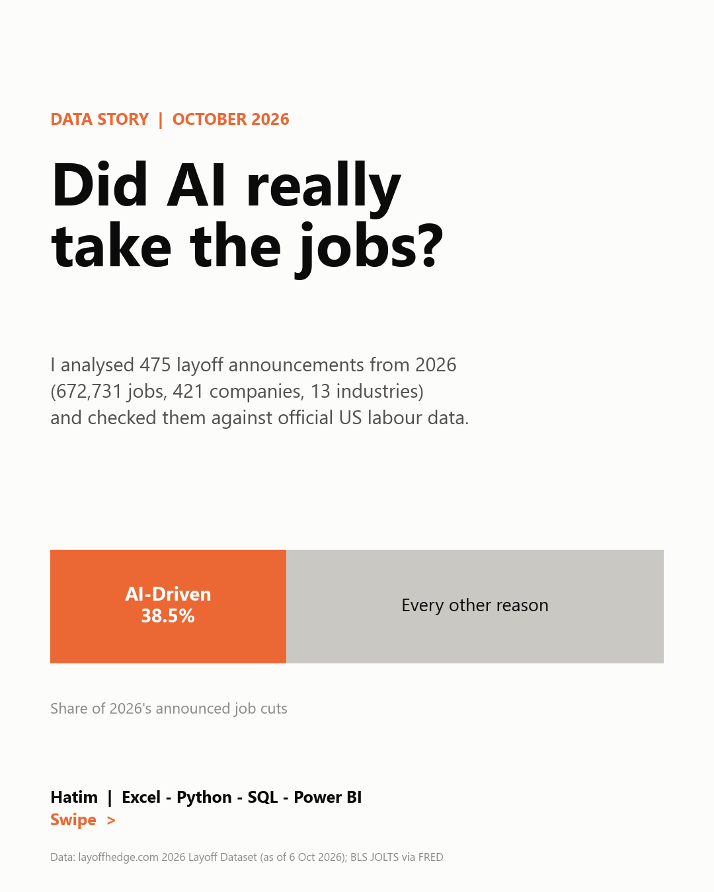
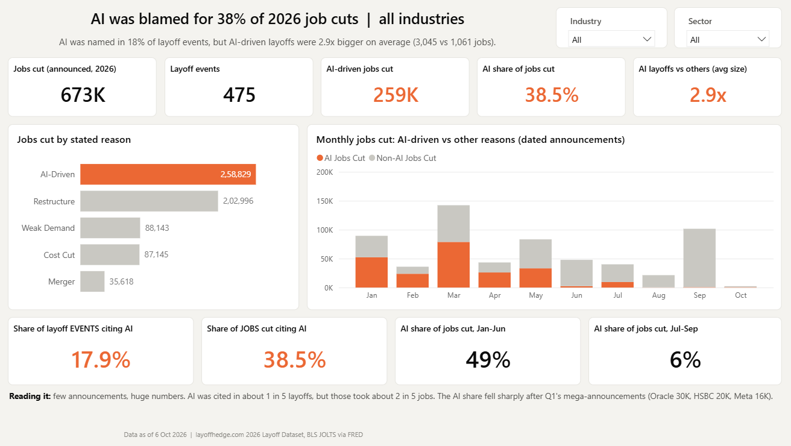

# Did AI Really Take the Jobs? An Analysis of 2026 Layoffs

**An end-to-end analytics project: Python → SQL → Excel → Power BI**

In 2026, "AI" became the most common reason companies gave for cutting jobs. I analysed **475 layoff
announcements (672,731 jobs, 421 companies, 13 industries)** to separate the headline from reality.
I then checked the results against official US labour-market data from the Bureau of Labor Statistics.



## Key findings

| # | Finding | Evidence |
|---|---|---|
| 1 | **AI is now the #1 stated reason for job cuts:** 258,829 jobs, **38.5%** of all cuts | SQL Q02 |
| 2 | **Few announcements, huge numbers:** AI was named in only **17.9%** of layoff events, but AI-driven layoffs averaged **3,045 jobs vs 1,061** for other reasons (2.9x) | SQL Q01, Q03 |
| 3 | **Banks blame AI almost as much as Big Tech:** AI-driven share of cuts is Crypto & Fintech **82%**, Tech **73%**, Finance & Banking **72%**, vs Retail 8% and Healthcare 0% | SQL Q04 |
| 4 | **The AI wave was front-loaded:** AI share of jobs cut was **49%** in Jan–Jun but **6%** in Jul–Sep (Oracle 30K, HSBC 20K, Meta 16K all landed in Q1) | SQL Q05 |
| 5 | **Reality check:** US employers lay off ~**1.7M people per month** (BLS JOLTS), flat vs 2024–25. All AI-driven cuts announced worldwide in 2026 equal about **15% of one month** of US layoffs | SQL Q12 |

**Bottom line:** the headline is real, but the wave isn't (yet). "AI" is a reason big companies give;
it doesn't yet show up as a labour-market shock in official statistics.

## Architecture

```
 layoffhedge.com CSV ─┐                                   ┌─> Excel workbook (interactive dashboard,
 BLS JOLTS via FRED ──┤                                   │     PivotTable + slicers, QA log)
                      ▼                                   │
             python/01_extract.py                         ├─> Power BI (star schema, 30+ DAX
                      ▼                                   │     measures, 4 pages + drill-through)
             python/02_clean_transform.py  ──> data/processed/ (star schema CSVs)
                      ▼                                   │
             python/03_load_sql.py ──> SQLite DB ──> 13 SQL analyses
                      ▼                                   │
             python/04_charts.py ──> images/ + LinkedIn carousel PDF
```

## What each tool does

### Python (pandas): extract, clean, model
- Pulls fresh data from 2 sources (`01_extract.py`)
- Cleaning challenges solved (`02_clean_transform.py`; full log in `data/processed/data_quality_log.csv`):
  - metadata comment lines above the CSV header
  - **mixed date formats:** `Oct 6`, `Mar 2026`, `2026`, `2025-30`. Each is parsed with a precision flag;
    year-level and multi-year plans stay in totals but are excluded from monthly trends rather than being forced into January
  - workforce % stored as text (`"7.4%"`), converted and validated against people_cut ÷ workforce
  - 9 full business closures flagged; 39 repeat layoffers sequenced
  - derived features: size, severity and layoff-size bands; tech/non-tech group; source credibility (news, WARN filing, SEC filing)
- **Reconciliation:** industry and monthly totals match the publisher's own aggregates **exactly** (13/13 industries, 10/10 months)
- Builds a **star schema**: 1 fact table + 4 dimension tables + 1 macro table

### SQL (SQLite, portable to SQL Server/Postgres)
- `sql/01_schema.sql`: typed tables with PK/FK, CHECK constraints and indexes
- `sql/02_analysis_queries.sql`: 13 business questions using **CTEs, window functions (RANK, ROW_NUMBER, LAG,
  running SUM OVER), median via window functions, conditional-aggregation pivots, and share-of-total**
- Results are exported to `data/processed/sql_results/`

### Excel
`excel/AI_Layoffs_2026_Analysis.xlsx`
- **Interactive dashboard:** an industry dropdown (data validation) drives every KPI, table and chart via `SUMIFS`/`COUNTIFS` on named ranges
- Native Excel charts, data-bar conditional formatting, and a built-in reconciliation check cell
- **PivotTable with 3 slicers** (sector, company size, severity), built in Excel by `excel/add_pivot_and_recalc.ps1`
- Data-quality log and data dictionary sheets. 125 formulas, 0 errors (verified in Excel)

### Power BI
`powerbi/AI_Layoffs_2026.pbip`: a ready-to-open Power BI Project, generated as code by `python/06_build_pbip.py`
(TMDL semantic model + PBIR report)



- Star-schema model, parameterised Power Query (M) load, custom theme
- 30+ DAX measures: time intelligence (MoM, running total), RANKX, ALLSELECTED share-of-total, dynamic titles,
  measure-driven conditional colours
- Pages: Overview, Industries & Companies (decomposition tree, heatmap matrix), Reality Check (BLS), plus a Company drill-through and a tooltip page
- Step-by-step build: [`powerbi/BUILD_GUIDE.md`](powerbi/BUILD_GUIDE.md)

## Run it yourself

```bash
pip install -r requirements.txt
python run_all.py            # downloads the latest data and rebuilds everything
python run_all.py --offline  # rebuild from data/raw only
```
(The Excel PivotTable step needs Windows + Microsoft Excel; everything else is cross-platform.)

## Repository layout

```
data/raw/              source files as downloaded
data/processed/        clean flat table, star schema, DQ log, SQL results
python/                01_extract → 05_build_excel
sql/                   schema + analysis queries
database/              layoffs_2026.db (SQLite)
excel/                 workbook + Excel automation script
powerbi/               theme, M queries, DAX, build guide
images/                charts (1080×1350, LinkedIn-ready)
linkedin/              carousel PDF + post copy
```

## Limitations (read before quoting the numbers)
- The "AI-Driven" label reflects **what companies said**, as categorised by the data publisher. It is not proof that AI caused the cuts.
- Announcements are not completed layoffs; multi-year programs (e.g. Bosch 2025–30) are counted once, when announced.
- Coverage of small companies relies on WARN filings and news, so recent months contain many small events.
- The layoff dataset is global, while BLS JOLTS is US-only, so the comparison shows scale, not like-for-like.

## Data sources
- layoffhedge. (2026). *2026 Layoff Dataset*. Retrieved 2026-10-06 from https://layoffhedge.com/data/ (free to use with attribution)
- U.S. Bureau of Labor Statistics, JOLTS (JTSLDL, JTU510099LDL, JTSJOL) and CPS (UNRATE), via FRED, Federal Reserve Bank of St. Louis
